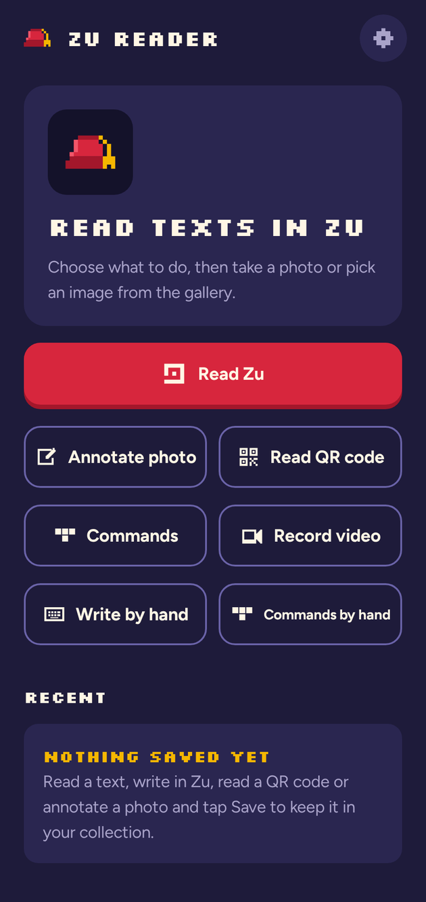
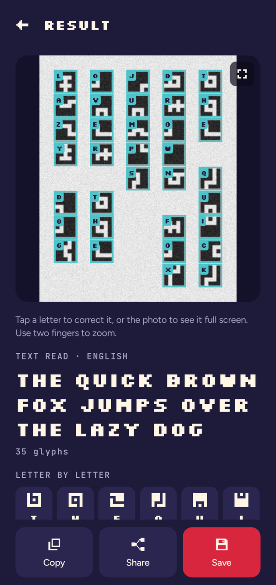
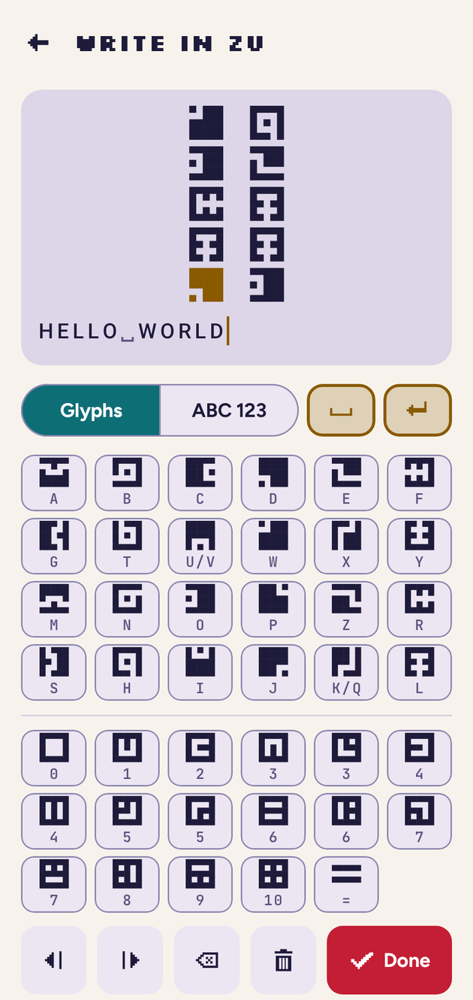
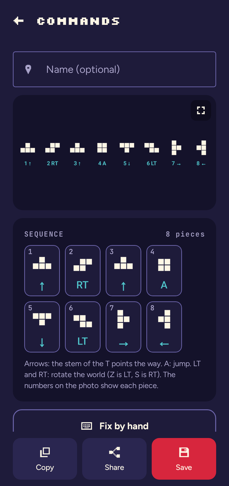

<p align="center">
  
</p>

<h1 align="center">Zu Reader</h1>

<p align="center">
  Read and write <b>Zu</b>, the alphabet from the game <i>FEZ</i>, with your phone's camera.<br>
  An open-source Android app made by fans.
</p>

<p align="center">
  <a href="../../releases"></a>
  <a href="../../actions/workflows/release.yml"></a>
  
  <a href="LICENSE"></a>
</p>

<p align="center">
  <b>English</b> · <a href="README.pt-BR.md">Português</a>
</p>

<p align="center">
  
  
  
  
</p>

## Features

- **Read Zu**: take a photo (or pick one from the gallery), crop around the text, and get the English text. Each glyph is marked on the photo; tap a letter to correct it.
- **Numbers**: reads Zu numbers too (0–10). An automatic mode tells letters and numbers apart.
- **Write by hand**: type with a glyph keyboard (or letters) and see the text drawn in Zu, with a cursor like a normal text field.
- **Commands**: reads the tetromino command sequences from the game, glued or separate, in rows or columns, and shows the button for each piece (↑ ↓ ← →, A, LT, RT). You can also correct or create sequences by hand.
- **QR codes, annotations and video**: read QR codes, draw on photos, and record up to 10 minutes of gameplay to read frames later.
- **Collection**: save anything you read or write, with a name and a description, and share it as an image plus text.
- Light and dark themes, English and Portuguese. **Works offline**: no account, no ads, no tracking.

## Install

<p>
  <a href="https://github.com/davicolzer/zu-reader/releases/latest/download/zu-reader.apk"></a>
</p>

1. On your phone, tap **Download APK** above (or get it from the [latest release](https://github.com/davicolzer/zu-reader/releases/latest)).
2. Open the file. If Android asks, allow installs from that source.
3. New versions install over the old one and keep your collection.

Requires Android 8.0 or newer.

**Check the download.** Official APKs come only from this repository's Releases and are signed with this certificate (SHA-256):

```
75:83:05:03:22:DA:39:AF:A9:B6:A4:01:B1:D9:EE:D2:67:08:52:C2:C1:BF:39:34:01:67:5E:88:FE:15:AD:10
```

To check: `apksigner verify --print-certs zu-reader.apk`. A different fingerprint means the file did not come from here; do not install it.

## How it works

The reader is plain Kotlin with no ML framework, so it runs fully on the device:

1. **Ink mask**: global and local thresholds at several scales, for dark-on-light and light-on-dark text. If the result is weak, it also tries color variants (contrast, R/G/B channels, saturation).
2. **Glyph boxes**: every glyph fills all rows and columns of its 5×5 grid, so the mask is split by its projections. Skew up to ±12° and stretching up to 3× are corrected.
3. **Classification**: each glyph becomes a 5×5 bit matrix and is matched against the 24 Zu glyphs (6 shapes × 4 rotations) by Hamming distance.
4. **Text**: a Viterbi search over English letter pairs picks the most likely letters. This resolves the pairs that share a glyph (K/Q, U/V) and noisy blocks.

Columns are read top to bottom, right to left, as in the game. Horizontal reading is an option in the settings.

## Build from source

You need **JDK 25** and the **Android SDK** with platform 37 (Android Studio installs it).

```bash
git clone https://github.com/davicolzer/zu-reader.git
cd zu-reader
./gradlew build                # compile, run all tests and lint
./gradlew :app:installDebug    # install on a connected device or emulator
./gradlew :core:vision:test    # only the image-reading tests (no emulator needed)
```

| Tool | Version |
|---|---|
| JDK | 25 (LTS); bytecode targets Java 21 |
| Gradle | 9.8.2 |
| Kotlin | 2.4.21 |
| Android Gradle Plugin | 9.5.1 |
| Compose BOM | 2026.09.00 |
| compileSdk / targetSdk | 37 |
| minSdk | 26 (Android 8.0) |

## Project structure

```
app/            Android app (Jetpack Compose, CameraX, Room, DataStore)
  data/         collection (Room), settings (DataStore), language
  media/        loading and straightening photos, shrinking videos
  ui/           one folder per screen; ZuReaderApp (navigation) and ReaderViewModel (state)
core/zu/        pure Kotlin: Zu alphabet, classifier, reading order, English model
core/vision/    pure Kotlin: image → glyphs, numbers, commands, QR codes, writing in Zu
testdata/real/  real photos used by the regression tests
tools/          helper scripts (English letter-pair table, glyph network training)
docs/           roadmap (PLANO.md), release guide, design files
```

The `core` modules do not depend on Android, so the readers are tested quickly on the JVM with real and synthetic images.

## Contributing

Bug reports, ideas and pull requests are welcome. **Photos where the app reads wrong are especially useful.** See [CONTRIBUTING.md](CONTRIBUTING.md).

- [Report a bug](../../issues/new?template=bug_report.yml)
- [Suggest a feature](../../issues/new?template=feature_request.yml)
- Roadmap (in Portuguese): [docs/PLANO.md](docs/PLANO.md)

## Credits and licenses

- Code: [MIT](LICENSE).
- Zu glyph shapes from [FEZ Pixel Font](https://github.com/TakWolf/fez-pixel-font) by TakWolf (CC0).
- English letter pairs built from the NLTK Gutenberg corpus (public-domain books) with `tools/gen_english_bigrams.py`.
- Fonts: Silkscreen, Figtree and JetBrains Mono, under the SIL Open Font License (see `third_party/fonts/`).
- The photos in `testdata/real/` are screenshots of *FEZ*, used only to test the reader.

**Fan project, not affiliated with Polytron.** *FEZ* and the Zu alphabet belong to Polytron Corporation. The app icon and artwork are original.
