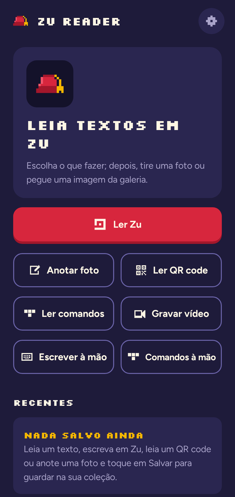
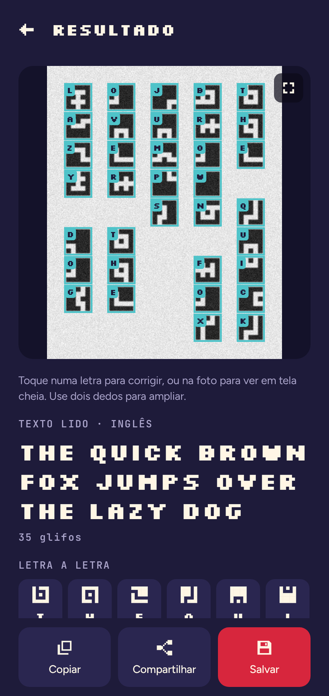
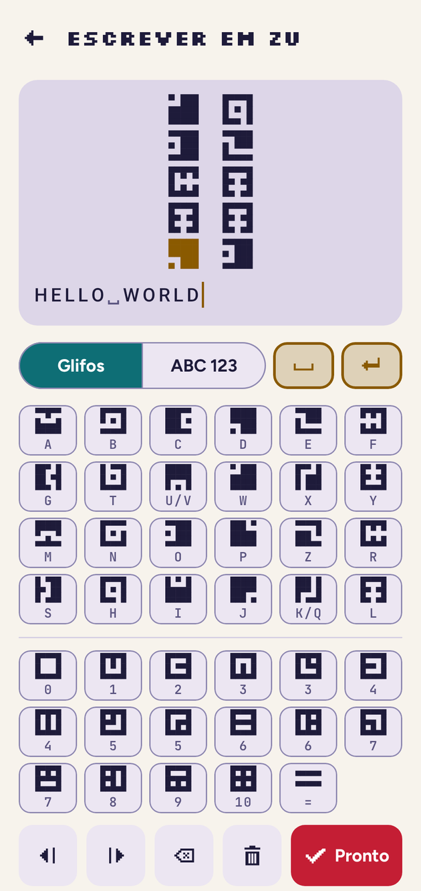
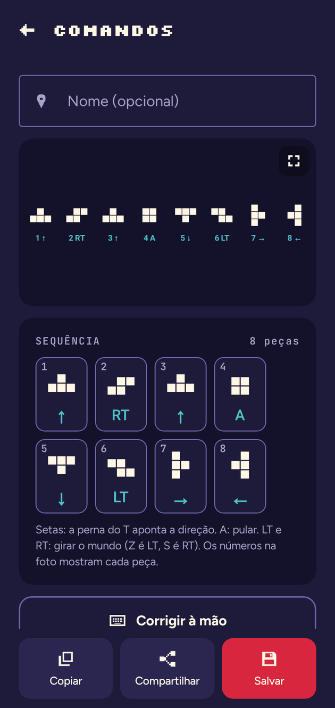

<p align="center">
  
</p>

<h1 align="center">Zu Reader</h1>

<p align="center">
  Leia e escreva <b>Zu</b>, o alfabeto do jogo <i>FEZ</i>, com a câmera do celular.<br>
  Um app Android de código aberto, feito por fãs.
</p>

<p align="center">
  <a href="../../releases"></a>
  <a href="../../actions/workflows/release.yml"></a>
  
  <a href="LICENSE"></a>
</p>

<p align="center">
  <a href="README.md">English</a> · <b>Português</b>
</p>

<p align="center">
  
  
  
  
</p>

## O que o app faz

- **Ler Zu**: tire uma foto (ou escolha da galeria), recorte em volta do texto e veja o texto em inglês. Cada glifo fica marcado na foto; toque numa letra para corrigir.
- **Números**: lê também os números do Zu (0–10). O modo automático separa letras e números sozinho.
- **Escrever à mão**: digite com um teclado de glifos (ou de letras) e veja o texto desenhado em Zu, com cursor como num campo de texto.
- **Comandos**: lê as sequências de comandos em peças de Tetris do jogo, coladas ou separadas, em linha ou em coluna, e mostra o botão de cada peça (↑ ↓ ← →, A, LT, RT). Dá também para corrigir ou montar sequências à mão.
- **QR code, anotações e vídeo**: lê QR codes, desenha sobre fotos e grava até 10 minutos do jogo para ler os quadros depois.
- **Coleção**: salve o que leu ou escreveu, com nome e descrição, e compartilhe como imagem e texto.
- Tema claro e escuro, inglês e português. **Funciona sem internet**: sem conta, sem anúncios, sem rastreamento.

## Instalar

<p>
  <a href="https://github.com/davicolzer/zu-reader/releases/latest/download/zu-reader.apk"></a>
</p>

1. No celular, toque em **Baixar APK** acima (ou pegue na [release mais recente](https://github.com/davicolzer/zu-reader/releases/latest)).
2. Abra o arquivo. Se o Android pedir, permita instalar apps dessa fonte.
3. Versões novas instalam por cima da anterior e mantêm a coleção.

Precisa de Android 8.0 ou mais novo.

**Confira o download.** Os APKs oficiais vêm só das Releases deste repositório e são assinados com este certificado (SHA-256):

```
75:83:05:03:22:DA:39:AF:A9:B6:A4:01:B1:D9:EE:D2:67:08:52:C2:C1:BF:39:34:01:67:5E:88:FE:15:AD:10
```

Para conferir: `apksigner verify --print-certs zu-reader.apk`. Uma impressão digital diferente quer dizer que o arquivo não veio daqui; não instale.

## Como funciona

O leitor é Kotlin puro, sem framework de aprendizado de máquina, e roda inteiro no aparelho:

1. **Máscara de tinta**: limiar global e local em várias escalas, para texto escuro no claro e claro no escuro. Se a leitura sair fraca, testa também versões de cor (contraste, canais R/G/B, saturação).
2. **Caixas dos glifos**: todo glifo ocupa todas as linhas e colunas da sua grade 5×5, então a máscara é cortada pelas projeções. Inclinação até ±12° e esticamento até 3× são corrigidos.
3. **Classificação**: cada glifo vira uma matriz 5×5 e é comparado com os 24 glifos do Zu (6 formas × 4 rotações) pela distância de Hamming.
4. **Texto**: uma busca de Viterbi sobre pares de letras do inglês escolhe as letras mais prováveis. Isso resolve os pares que dividem o mesmo glifo (K/Q, U/V) e os blocos com ruído.

As colunas são lidas de cima para baixo, da direita para a esquerda, como no jogo. A leitura horizontal é uma opção nas configurações.

## Compilar

Precisa de **JDK 25** e do **Android SDK** com a plataforma 37 (o Android Studio instala).

```bash
git clone https://github.com/davicolzer/zu-reader.git
cd zu-reader
./gradlew build                # compila, roda todos os testes e o lint
./gradlew :app:installDebug    # instala no aparelho ou emulador conectado
./gradlew :core:vision:test    # só os testes de leitura de imagem (sem emulador)
```

Versões das ferramentas e a estrutura do projeto estão no [README em inglês](README.md#build-from-source).

## Contribuir

Achou um problema ou tem uma ideia? **Abra uma issue**: o mantenedor faz as mudanças (só ele abre pull requests). **Fotos em que o app lê errado ajudam muito.** Veja o [CONTRIBUTING.md](CONTRIBUTING.md); as issues podem ser em português ou em inglês.

- [Relatar um erro](../../issues/new?template=bug_report.yml)
- [Sugerir uma função](../../issues/new?template=feature_request.yml)
- Roadmap: [docs/PLANO.md](docs/PLANO.md)

## Créditos e licenças

- Código: [MIT](LICENSE).
- Desenhos dos glifos Zu da [FEZ Pixel Font](https://github.com/TakWolf/fez-pixel-font), de TakWolf (CC0).
- Pares de letras do inglês gerados a partir do corpus Gutenberg do NLTK (livros em domínio público), com `tools/gen_english_bigrams.py`.
- Fontes Silkscreen, Figtree e JetBrains Mono, sob a SIL Open Font License (ver `third_party/fonts/`).
- As fotos em `testdata/real/` são capturas do *FEZ*, usadas só para testar o leitor.

**Projeto de fã, sem vínculo com a Polytron.** O *FEZ* e o alfabeto Zu pertencem à Polytron Corporation. O ícone e a arte do app são originais.
