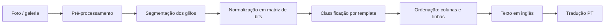

# Plano: leitor e tradutor do alfabeto Zu (Fez) em Kotlin

> Projeto de fã, sem vínculo com a Polytron. Não usamos sprites, logos nem assets do jogo:
> o ícone (chapéu fez) e a paleta são arte original inspirada no clima do jogo.

## 1. Objetivo

Um app Android simples:

1. **Tirar uma foto** (ou escolher da galeria) de um texto escrito no alfabeto Zu.
2. **Ler os glifos** da imagem e montar o texto (em inglês, porque o Zu é uma cifra de substituição do alfabeto latino).
3. **Traduzir** o texto para português.

Nome sugerido: **Zu Reader**. Evitar "Fez" no nome publicado na Play Store para não esbarrar em marca registrada. O repositório pode continuar `fez-translate`.

## 2. O alfabeto Zu (validado na Fase 1)

| Ponto | O que sabemos | Como o app trata |
|---|---|---|
| Natureza | Cifra de substituição: cada glifo = uma letra latina | Tabela glifo → letra (`ZuAlphabet`) |
| Forma | Grade 5×5 de blocos | `BitMatrix` 5×5 |
| Quantidade | **24 glifos para 26 letras**: K/Q e U/V compartilham glifo | O modelo de inglês escolhe a letra pelo contexto (QUICK, OVER) |
| Estrutura | **6 formas, cada uma em 4 rotações** (ex.: A, G, M, S são a mesma forma girada) | Nunca girar glifo por glifo: a rotação muda a letra |
| Rotação da foto | Um texto girado também forma letras válidas | Testar as 4 orientações do texto inteiro e escolher a mais parecida com inglês |
| Direção | Colunas de cima para baixo, da direita para a esquerda | Padrão; opção horizontal |
| Números | Sistema separado (0–10, com variantes de 3–7) | Fora do MVP (Fase 6); os desenhos já estão na fonte de referência |

Fonte dos desenhos: [FEZ Pixel Font, de TakWolf](https://github.com/TakWolf/fez-pixel-font) (CC0). O alfabeto pertence à Polytron.

Referências: [StrategyWiki: Fez/Alphabet](https://StrategyWiki.org/wiki/Fez/Alphabet), [dCode: Fez alphabet](https://www.dcode.fr/fez-alphabet), [Zu Language typeface (itch.io)](https://themizarkshow.itch.io/zu-language).

## 3. Arquitetura

### Stack

| Camada | Escolha | Por quê |
|---|---|---|
| Linguagem | Kotlin 2.x | Pedido do projeto |
| UI | Jetpack Compose + Material 3 | Tema próprio com a paleta do design |
| Câmera | CameraX (`Preview`, `ImageCapture`, `ImageAnalysis`) | Preview e detecção ao vivo |
| Galeria | Photo Picker (`PickVisualMedia`) | Sem permissão de armazenamento |
| Visão | OpenCV para Android | Limiar, contornos, correção de perspectiva |
| Classificação | Template matching (MVP) → TensorFlow Lite (Fase 6) | MVP sem treinar modelo |
| Tradução | ML Kit Translation (EN → PT, on-device) | Gratuito e funciona offline após baixar o pacote |
| Persistência | Room (histórico) + DataStore (preferências) | |
| DI | Hilt | |
| Imagens | Coil | |
| Testes | JUnit 5, Turbine, Compose UI Test | |
| CI | GitHub Actions (build + testes + lint) | |

`minSdk 26`, `targetSdk` mais recente. Tudo roda no aparelho, sem servidor.

### Módulos

```
fez-translate/
├── app/                      # Activity, navegação, tema, DI
├── core/zu/                  # Kotlin puro: alfabeto, BitMatrix, decoder, ordenação
├── core/vision/              # OpenCV: pré-processamento, segmentação, normalização
├── core/data/                # Room, DataStore, repositórios
├── feature/home/
├── feature/camera/
├── feature/result/           # resultado + correção de letra
└── feature/history/
```

`core/zu` é Kotlin/JVM puro: toda a lógica de reconhecimento testável sem emulador.

### Modelos principais (`core/zu`)

```kotlin
class BitMatrix                       // grade de blocos; rotate(), hammingDistance()
data class ZuGlyph(val letters: String, val pattern: BitMatrix)   // "KQ", "UV" ou uma letra
data class PlacedGlyph(val x: Float, val y: Float, val size: Float, val bits: BitMatrix)

class GlyphClassifier { fun classify(bits: BitMatrix): GlyphClassification }
object ZuLayout { fun order(...); fun compose(text, ...); fun rotate(glyphs, quarterTurns) }

class ZuReader { fun read(glyphs: List<PlacedGlyph>, rotation: Int? = null): ZuReading }
data class ZuReading(val text: String, val glyphs: List<GlyphReading>, val rotation: Int, ...)
data class GlyphReading(val source: PlacedGlyph, val letter: Char, val confidence: Float,
                        val alternatives: List<LetterScore>)
```

A Fase 2 só precisa transformar a foto em `List<PlacedGlyph>`; o resto já existe.

## 4. Pipeline de leitura



1. **Pré-processamento**: escala de cinza; desfoque gaussiano leve (reduz o moiré de foto tirada da tela); limiar adaptativo/Otsu; inverter se o texto for claro em fundo escuro (detectar pela proporção de pixels); abertura/fechamento morfológico.
2. **Recorte da área** (opcional): o usuário ajusta os 4 cantos; aplicamos `warpPerspective` para endireitar a foto tirada de lado.
3. **Segmentação**: `findContours` → caixas delimitadoras; filtrar por proporção ≈ 1:1 e por tamanho próximo da mediana (os glifos têm tamanho uniforme); juntar blocos do mesmo glifo pela distância entre eles.
4. **Normalização**: cada caixa é reamostrada para a grade 5×5 do glifo, tirando a média de pixels em cada célula → `BitMatrix`.
5. **Classificação**: distância de Hamming contra os 24 modelos, sem girar o glifo. Confiança = folga para o segundo colocado × proximidade do modelo (exato = 1; 1 bloco errado sem empate = 0,8; empate = 0). Abaixo de 0,7 vira "letra com dúvida" (dourado na UI).
6. **Ordenação**: agrupar em colunas pelo centro X (tolerância de meio glifo); colunas da direita para a esquerda, glifos de cima para baixo. Fim de coluna e vãos maiores que 1,75 glifo viram espaço (suposição a validar com prints reais).
7. **Texto e orientação**: para cada uma das 4 orientações, Viterbi sobre pares de letras do inglês escolhe a sequência mais provável (resolve K/Q, U/V e blocos com ruído). Vence a orientação de maior pontuação; girar a foto tem um custo fixo, porque fotos costumam estar em pé e textos de até 3 letras são ambíguos.
8. **Tradução**: ML Kit traduz o texto em inglês; mostramos os dois.

Na câmera ao vivo, os passos 1 a 5 rodam no `ImageAnalysis` a cada ~300 ms em resolução reduzida, só para desenhar as caixas e o contador "7 glifos". A leitura completa roda na foto em resolução cheia.

## 5. Telas (ver `docs/design/mockup.html`)

1. **Início**: botão "Fotografar" (vermelho), "Escolher da galeria", lista de recentes.
2. **Câmera**: guia com cantos dourados, caixas turquesa nos glifos detectados, dourado nos duvidosos, contador de glifos, flash, galeria.
3. **Resultado**: foto com as caixas, texto lido em fonte pixel, tradução, faixa glifo → letra, ações Copiar / Compartilhar / Salvar.
4. **Corrigir letra** (bottom sheet): glifo ampliado, top-3 sugestões com confiança, teclado A–Z. A correção atualiza o texto e a tradução na hora e fica salva como exemplo local.
5. **Histórico** e **Configurações** (direção de leitura, idioma da tradução, tema claro/escuro).

### Identidade visual

| Token | Cor | Uso |
|---|---|---|
| Night | `#1E1B3A` | Fundo (céu noturno) |
| Surface | `#2A2650` | Cards, sheets |
| Fez Red | `#D7263D` | Ação principal |
| Fez Deep | `#A3172B` | Pressionado, sombra do botão |
| Cube Gold | `#F5B700` | Destaques, letra com dúvida, links |
| Scan Teal | `#4FC3C9` | Glifo detectado, sucesso |
| Paper | `#FFF6E5` | Texto principal |
| Muted | `#A9A3C9` | Texto secundário |

Fontes: **Silkscreen** (títulos e texto lido, pixel), **Figtree** (interface), **JetBrains Mono** (números/confiança), todas OFL, empacotadas em `res/font`.
Ícone: `docs/design/icon.svg` (chapéu fez 16×16), convertido em adaptive icon (foreground vetorial + fundo `#1E1B3A`).

## 6. Fases

| Fase | Entrega | Pronto quando |
|---|---|---|
| **0. Setup** ✅ | Projeto Gradle multi-módulo (version catalog), tema Compose com a paleta, ícone, CI no GitHub Actions. JDK 25 LTS, Gradle 9.8.2, Kotlin 2.4.21, AGP 9.5.1 | `./gradlew build` verde no CI; app abre a tela inicial |
| **1. Alfabeto + decoder** ✅ | `core/zu`: 24 glifos, classificador por distância, ordenação de colunas, modelo de pares de letras do inglês, escolha da orientação | Testes: frases sintéticas lidas certas em pé e giradas (≥ 4 letras); 99,8% de acerto por caractere com 1 bloco errado em cada glifo |
| **2. Visão em imagem estática** | `core/vision` com OpenCV; tela de galeria → resultado | ≥ 95% das letras corretas em um conjunto de 30 prints do jogo |
| **3. Câmera** | CameraX, overlay ao vivo, captura, recorte por cantos | ≥ 85% das letras corretas em 30 fotos de monitor/TV |
| **4. Resultado e tradução** | Tela de resultado, correção de letra, ML Kit EN→PT, copiar/compartilhar, histórico (Room) | Fluxo completo foto → texto → tradução → salvo |
| **5. Polimento** | Acessibilidade (TalkBack, contraste, alvos ≥ 48 dp), tema claro, estados vazios e de erro, ícone final, release assinado | Checklist de acessibilidade ok; APK/AAB gerado no CI |
| **6. Evolução (opcional)** | Modelo TFLite treinado com dados sintéticos + correções do usuário; números Zu; leitura totalmente ao vivo | Acurácia em fotos ≥ 95% |

### Dados de teste

- **Prints**: capturas do próprio jogo (de quem tem o jogo), guardadas fora do repositório público se houver dúvida de direitos.
- **Sintéticos**: script que renderiza os templates com ruído, desfoque, perspectiva, moiré e variação de cor. Serve para os testes da Fase 2 e para treinar o modelo da Fase 6.
- Métrica: taxa de acerto por letra e por frase, registrada a cada PR no CI.

## 7. Riscos

| Risco | Mitigação |
|---|---|
| Moiré e reflexo em foto de tela | Desfoque antes do limiar, dica na câmera ("afaste um pouco"), importar print pela galeria |
| K/Q e U/V com o mesmo glifo; B/H/N/T e F/L/R/Y a 2 blocos de distância | Contexto do inglês escolhe; empates marcados como dúvida com alternativas |
| Texto girado | As 4 orientações são testadas; textos de até 3 letras ficam na orientação da foto |
| Glifos colados ou muito pequenos | Exigir tamanho mínimo; recorte manual; zoom na câmera |
| Marca "Fez" | Nome do app sem "Fez"; aviso de projeto de fã; nenhum asset do jogo |

## 8. Próximos passos

1. Aprovar este plano e o design (`docs/design/mockup.png`).
2. Fase 0: criar o projeto Android no repositório.
3. Fase 2: com prints reais do jogo, validar a direção de leitura, como as palavras são separadas e a orientação dos glifos.
