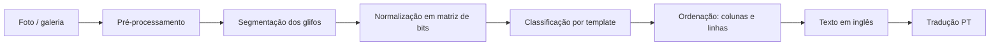

# Plano: leitor e tradutor do alfabeto Zu (Fez) em Kotlin

> Projeto de fã, sem vínculo com a Polytron. Não usamos sprites, logos nem assets do jogo:
> o ícone (chapéu fez) e a paleta são arte original inspirada no clima do jogo.

## 1. Objetivo

Um app Android simples:

1. **Tirar uma foto** (ou escolher da galeria) de um texto escrito no alfabeto Zu.
2. **Ler os glifos** da imagem e montar o texto (em inglês, porque o Zu é uma cifra de substituição do alfabeto latino).
3. **Traduzir** o texto para português.

Nome sugerido: **Zu Reader**. Evitar "Fez" no nome publicado na Play Store para não esbarrar em marca registrada. O repositório pode continuar `fez-translate`.

## 2. O que sabemos do alfabeto Zu (validar na Fase 1)

| Ponto | O que as fontes dizem | Como o app trata |
|---|---|---|
| Natureza | Cifra de substituição: cada glifo = uma letra latina | Tabela glifo → letra, sem dicionário |
| Forma | Glifos quadrados em pixel art, compostos por blocos | Ler cada glifo como uma matriz de bits |
| Direção | Colunas de cima para baixo, colunas da direita para a esquerda | Ordem padrão, com opção "horizontal" nas configurações |
| Rotação | No jogo, o texto pode aparecer girado conforme a câmera | Testar as 4 rotações e ficar com a de melhor pontuação |
| Números | Sistema numérico separado, formado de outro jeito | Fora do MVP (Fase 6) |
| Quantidade | Fontes divergem sobre o total de letras (24 ou 26); algumas letras podem compartilhar glifo | Conferir na sala da Pedra de Roseta do jogo e registrar letras ambíguas |

Referências: [StrategyWiki: Fez/Alphabet](https://StrategyWiki.org/wiki/Fez/Alphabet), [dCode: Fez alphabet](https://www.dcode.fr/fez-alphabet), [Zu Language typeface (itch.io)](https://themizarkshow.itch.io/zu-language).

## 3. Arquitetura

### Stack

| Camada | Escolha | Por quê |
|---|---|---|
| Linguagem | Kotlin 2.x | Pedido do projeto |
| UI | Jetpack Compose + Material 3 | Tema próprio com a paleta do design |
| Câmera | CameraX (`Preview`, `ImageCapture`, `ImageAnalysis`) | Preview e detecção ao vivo |
| Galeria | Photo Picker (`PickVisualMedia`) | Sem permissão de armazenamento |
| Visão | OpenCV para Android | Limiar, contornos, correção de perspectiva |
| Classificação | Template matching (MVP) → TensorFlow Lite (Fase 6) | MVP sem treinar modelo |
| Tradução | ML Kit Translation (EN → PT, on-device) | Gratuito e funciona offline após baixar o pacote |
| Persistência | Room (histórico) + DataStore (preferências) | |
| DI | Hilt | |
| Imagens | Coil | |
| Testes | JUnit 5, Turbine, Compose UI Test | |
| CI | GitHub Actions (build + testes + lint) | |

`minSdk 26`, `targetSdk` mais recente. Tudo roda no aparelho, sem servidor.

### Módulos

```
fez-translate/
├── app/                      # Activity, navegação, tema, DI
├── core/zu/                  # Kotlin puro: alfabeto, BitMatrix, decoder, ordenação
├── core/vision/              # OpenCV: pré-processamento, segmentação, normalização
├── core/data/                # Room, DataStore, repositórios
├── feature/home/
├── feature/camera/
├── feature/result/           # resultado + correção de letra
└── feature/history/
```

`core/zu` é Kotlin/JVM puro: toda a lógica de reconhecimento testável sem emulador.

### Modelos principais

```kotlin
// core/zu
@JvmInline value class BitMatrix(val rows: List<BooleanArray>)

data class ZuGlyph(val letter: Char, val pattern: BitMatrix)

data class DetectedGlyph(
    val bounds: RectF,          // posição na foto
    val bits: BitMatrix,        // glifo normalizado
)

data class GlyphReading(
    val glyph: DetectedGlyph,
    val letter: Char,
    val confidence: Float,      // 0..1
    val alternatives: List<Pair<Char, Float>>, // top-3 para a tela de correção
)

data class ZuReading(
    val text: String,
    val glyphs: List<GlyphReading>,
    val rotation: Int,          // 0, 90, 180, 270
    val direction: ReadingDirection,
)

interface ZuRecognizer {
    suspend fun read(image: Bitmap): ZuReading
}
```

## 4. Pipeline de leitura



1. **Pré-processamento**: escala de cinza; desfoque gaussiano leve (reduz o moiré de foto tirada da tela); limiar adaptativo/Otsu; inverter se o texto for claro em fundo escuro (detectar pela proporção de pixels); abertura/fechamento morfológico.
2. **Recorte da área** (opcional): o usuário ajusta os 4 cantos; aplicamos `warpPerspective` para endireitar a foto tirada de lado.
3. **Segmentação**: `findContours` → caixas delimitadoras; filtrar por proporção ≈ 1:1 e por tamanho próximo da mediana (os glifos têm tamanho uniforme); juntar blocos do mesmo glifo pela distância entre eles.
4. **Normalização**: cada caixa é reamostrada para a grade nativa do glifo (ex.: 5×5 ou a que a Fase 1 confirmar), tirando a média de pixels em cada célula → `BitMatrix`.
5. **Classificação**: distância de Hamming/IoU contra os templates, em 4 rotações. Confiança = `1 - distância_normalizada`, com margem para a segunda opção. Abaixo de 0,7 vira "letra com dúvida" (dourado na UI).
6. **Orientação global**: escolher a rotação que maximiza a soma das confianças de todos os glifos (o texto inteiro gira junto).
7. **Ordenação**: agrupar caixas em colunas pelo centro X (agrupamento 1D com tolerância de meia largura de glifo); colunas da direita para a esquerda, glifos de cima para baixo. Espaços: lacunas maiores que ~1,5 glifo viram espaço.
8. **Tradução**: ML Kit traduz o texto em inglês; mostramos os dois.

Na câmera ao vivo, os passos 1 a 5 rodam no `ImageAnalysis` a cada ~300 ms em resolução reduzida, só para desenhar as caixas e o contador "7 glifos". A leitura completa roda na foto em resolução cheia.

## 5. Telas (ver `docs/design/mockup.html`)

1. **Início**: botão "Fotografar" (vermelho), "Escolher da galeria", lista de recentes.
2. **Câmera**: guia com cantos dourados, caixas turquesa nos glifos detectados, dourado nos duvidosos, contador de glifos, flash, galeria.
3. **Resultado**: foto com as caixas, texto lido em fonte pixel, tradução, faixa glifo → letra, ações Copiar / Compartilhar / Salvar.
4. **Corrigir letra** (bottom sheet): glifo ampliado, top-3 sugestões com confiança, teclado A–Z. A correção atualiza o texto e a tradução na hora e fica salva como exemplo local.
5. **Histórico** e **Configurações** (direção de leitura, idioma da tradução, tema claro/escuro).

### Identidade visual

| Token | Cor | Uso |
|---|---|---|
| Night | `#1E1B3A` | Fundo (céu noturno) |
| Surface | `#2A2650` | Cards, sheets |
| Fez Red | `#D7263D` | Ação principal |
| Fez Deep | `#A3172B` | Pressionado, sombra do botão |
| Cube Gold | `#F5B700` | Destaques, letra com dúvida, links |
| Scan Teal | `#4FC3C9` | Glifo detectado, sucesso |
| Paper | `#FFF6E5` | Texto principal |
| Muted | `#A9A3C9` | Texto secundário |

Fontes: **Silkscreen** (títulos e texto lido, pixel), **Figtree** (interface), **JetBrains Mono** (números/confiança), todas OFL, empacotadas em `res/font`.
Ícone: `docs/design/icon.svg` (chapéu fez 16×16), convertido em adaptive icon (foreground vetorial + fundo `#1E1B3A`).

## 6. Fases

| Fase | Entrega | Pronto quando |
|---|---|---|
| **0. Setup** ✅ | Projeto Gradle multi-módulo (version catalog), tema Compose com a paleta, ícone, CI no GitHub Actions. JDK 25 LTS, Gradle 9.8.2, Kotlin 2.4.21, AGP 9.5.1 | `./gradlew build` verde no CI; app abre a tela inicial |
| **1. Alfabeto + decoder** | `core/zu`: tabela dos glifos (montada a partir da Pedra de Roseta do jogo), `BitMatrix`, classificador por template com rotações, ordenação de colunas | Testes unitários: matrizes sintéticas → texto correto, inclusive girado e com 1–2 bits de ruído |
| **2. Visão em imagem estática** | `core/vision` com OpenCV; tela de galeria → resultado | ≥ 95% das letras corretas em um conjunto de 30 prints do jogo |
| **3. Câmera** | CameraX, overlay ao vivo, captura, recorte por cantos | ≥ 85% das letras corretas em 30 fotos de monitor/TV |
| **4. Resultado e tradução** | Tela de resultado, correção de letra, ML Kit EN→PT, copiar/compartilhar, histórico (Room) | Fluxo completo foto → texto → tradução → salvo |
| **5. Polimento** | Acessibilidade (TalkBack, contraste, alvos ≥ 48 dp), tema claro, estados vazios e de erro, ícone final, release assinado | Checklist de acessibilidade ok; APK/AAB gerado no CI |
| **6. Evolução (opcional)** | Modelo TFLite treinado com dados sintéticos + correções do usuário; números Zu; leitura totalmente ao vivo | Acurácia em fotos ≥ 95% |

### Dados de teste

- **Prints**: capturas do próprio jogo (de quem tem o jogo), guardadas fora do repositório público se houver dúvida de direitos.
- **Sintéticos**: script que renderiza os templates com ruído, desfoque, perspectiva, moiré e variação de cor. Serve para os testes da Fase 1 e para treinar o modelo da Fase 6.
- Métrica: taxa de acerto por letra e por frase, registrada a cada PR no CI.

## 7. Riscos

| Risco | Mitigação |
|---|---|
| Moiré e reflexo em foto de tela | Desfoque antes do limiar, dica na câmera ("afaste um pouco"), importar print pela galeria |
| Letras com glifo igual ou muito parecido | Mostrar alternativas e deixar o usuário corrigir; registrar pares ambíguos na tabela |
| Texto girado ou espelhado | Busca nas 4 rotações; opção de espelhar se a Fase 1 mostrar necessidade |
| Glifos colados ou muito pequenos | Exigir tamanho mínimo; recorte manual; zoom na câmera |
| Marca "Fez" | Nome do app sem "Fez"; aviso de projeto de fã; nenhum asset do jogo |

## 8. Próximos passos

1. Aprovar este plano e o design (`docs/design/mockup.png`).
2. Fase 0: criar o projeto Android no repositório.
3. Fase 1: cadastrar a tabela de glifos. Para isso, o melhor ponto de partida é um print nítido da sala da Pedra de Roseta.
