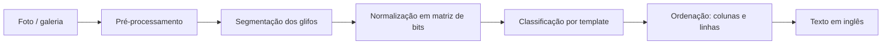

# Plano: leitor e tradutor do alfabeto Zu (Fez) em Kotlin

> Projeto de fã, sem vínculo com a Polytron. Não usamos sprites, logos nem assets do jogo:
> o ícone (chapéu fez) e a paleta são arte original inspirada no clima do jogo.

## 1. Objetivo

Um app Android simples:

1. **Tirar uma foto** (ou escolher da galeria) de um texto escrito no alfabeto Zu.
2. **Ler os glifos** da imagem e montar o texto (em inglês, porque o Zu é uma cifra de substituição do alfabeto latino).
3. ~~Traduzir o texto para português~~: fora do escopo por enquanto (fase opcional no fim). O app mostra o texto em inglês.

Nome sugerido: **Zu Reader**. Evitar "Fez" no nome publicado na Play Store para não esbarrar em marca registrada. O repositório pode continuar `fez-translate`.

## 2. O alfabeto Zu (validado na Fase 1)

| Ponto | O que sabemos | Como o app trata |
|---|---|---|
| Natureza | Cifra de substituição: cada glifo = uma letra latina | Tabela glifo → letra (`ZuAlphabet`) |
| Forma | Grade 5×5 de blocos | `BitMatrix` 5×5 |
| Quantidade | **24 glifos para 26 letras**: K/Q e U/V compartilham glifo | O modelo de inglês escolhe a letra pelo contexto (QUICK, OVER) |
| Estrutura | **6 formas, cada uma em 4 rotações** (ex.: A, G, M, S são a mesma forma girada) | Nunca girar glifo por glifo: a rotação muda a letra |
| Rotação da foto | Um texto girado também forma letras válidas | **Confiar na orientação da foto** (não adivinhar o giro): a câmera usa o sensor de movimento e fotografa em pé conforme o celular é segurado, mesmo com a rotação da tela travada; a galeria respeita o EXIF |
| Direção | Colunas de cima para baixo, da direita para a esquerda (**confirmado** com a parede "THE POINTS CONSTELLATE…") | Padrão; opção horizontal |
| Números | Sistema separado (0–10, com variantes de 3–7), todos com moldura e miolo 3×3; alguns ficam a só 1 bloco um do outro (ex.: 6 e 9). Também trocam de valor ao girar | **Modo separado** "Números" (Fase 8): não mistura letras e números; a confiança considera a folga de 1 bloco |

Fonte dos desenhos: [FEZ Pixel Font, de TakWolf](https://github.com/TakWolf/fez-pixel-font) (CC0). O alfabeto pertence à Polytron.

Referências: [StrategyWiki: Fez/Alphabet](https://StrategyWiki.org/wiki/Fez/Alphabet), [dCode: Fez alphabet](https://www.dcode.fr/fez-alphabet), [Zu Language typeface (itch.io)](https://themizarkshow.itch.io/zu-language).

## 3. Arquitetura

### Stack

| Camada | Escolha | Por quê |
|---|---|---|
| Linguagem | Kotlin 2.x | Pedido do projeto |
| UI | Jetpack Compose + Material 3 | Tema próprio com a paleta do design |
| Câmera | CameraX (`Preview`, `ImageCapture`, `ImageAnalysis`) | Preview e detecção ao vivo |
| Galeria | Photo Picker (`PickVisualMedia`) | Sem permissão de armazenamento |
| Visão | Kotlin puro (`core/vision`); OpenCV só se a Fase 3 pedir correção de perspectiva | Glifos são blocos: limiar, manchas e grade bastam. Testável na JVM e sem 30 MB de bibliotecas nativas |
| Classificação | Template matching (MVP) → TensorFlow Lite (Fase 6) | MVP sem treinar modelo |
| Tradução (opcional, depois) | ML Kit Translation (EN → PT, on-device) | Só se for retomada: gratuito e funciona offline após baixar o pacote |
| Persistência | Room (histórico) + DataStore (preferências) | |
| DI | Hilt | |
| Imagens | Coil | |
| Testes | JUnit 5, Turbine, Compose UI Test | |
| CI | GitHub Actions (build + testes + lint) | |

`minSdk 26`, `targetSdk` mais recente. Tudo roda no aparelho, sem servidor.

### Módulos

```
fez-translate/
├── app/                      # Activity, navegação, tema, DI
├── core/zu/                  # Kotlin puro: alfabeto, BitMatrix, decoder, ordenação
├── core/vision/              # Kotlin puro: limiar, manchas, caixas de glifo, grade 5×5
├── core/data/                # Room, DataStore, repositórios
├── feature/home/
├── feature/camera/
├── feature/result/           # resultado + correção de letra
└── feature/history/
```

`core/zu` é Kotlin/JVM puro: toda a lógica de reconhecimento testável sem emulador.

### Modelos principais (`core/zu`)

```kotlin
class BitMatrix                       // grade de blocos; rotate(), hammingDistance()
data class ZuGlyph(val letters: String, val pattern: BitMatrix)   // "KQ", "UV" ou uma letra
data class PlacedGlyph(val x: Float, val y: Float, val size: Float, val bits: BitMatrix)

class GlyphClassifier { fun classify(bits: BitMatrix): GlyphClassification }
object ZuLayout { fun order(...); fun compose(text, ...); fun rotate(glyphs, quarterTurns) }

class ZuReader { fun read(glyphs: List<PlacedGlyph>, rotation: Int? = null): ZuReading }
data class ZuReading(val text: String, val glyphs: List<GlyphReading>, val rotation: Int, ...)
data class GlyphReading(val source: PlacedGlyph, val letter: Char, val confidence: Float,
                        val alternatives: List<LetterScore>)
```

A Fase 2 só precisa transformar a foto em `List<PlacedGlyph>`; o resto já existe.

## 4. Pipeline de leitura



1. **Limiar**: escala de cinza (transparência vira branco) e limiar de Otsu. Testa texto escuro e texto claro e fica com o que encontra mais glifos confiáveis.
2. **Manchas**: componentes conectados (vizinhança de 8).
3. **Caixas de glifo**: a maioria dos glifos tem duas peças separadas por 1 bloco, o mesmo vão entre glifos, então não dá para juntar por distância. Mas todo glifo tem tinta em todas as linhas e colunas: a sombra das peças em cada eixo é contínua e do tamanho do glifo. Corta-se em faixas por um eixo e depois pelo outro (as duas ordens são testadas). Manchas grandes demais (molduras, cenário), sujeira e quadrados sólidos são descartados.
4. **Grade 5×5 de cada glifo**: cada célula vira bloco se mais da metade do seu miolo for tinta → `BitMatrix`. Células "meio a meio" indicam ruído e o glifo é descartado.

Antes do passo 2, a inclinação é medida (±12°) e a máscara é endireitada; a leitura endireitada só é usada se for melhor que a original. No passo 3, largura e altura do glifo são medidas separadamente (aceita imagem esticada) e glifos de tamanhos diferentes formam blocos separados, lidos com a mesma orientação.
5. **Classificação**: distância de Hamming contra os 24 modelos, sem girar o glifo. Confiança = folga para o segundo colocado × proximidade do modelo (exato = 1; 1 bloco errado sem empate = 0,8; empate = 0). Abaixo de 0,7 vira "letra com dúvida" (dourado na UI).
6. **Ordenação**: agrupar em colunas pelo centro X (tolerância de meio glifo); colunas da direita para a esquerda, glifos de cima para baixo. Fim de coluna e vãos maiores que 1,75 glifo viram espaço (suposição a validar com prints reais).
7. **Texto**: Viterbi sobre pares de letras do inglês escolhe a sequência mais provável (resolve K/Q, U/V e blocos com ruído), na orientação em que a foto chegou. (Antes o app testava as 4 orientações e escolhia a mais parecida com inglês; foi removido a pedido: textos curtos como "ZU" viravam "IE" de cabeça para baixo, e a câmera agora garante a foto em pé.)
8. **Tradução**: fora do escopo por enquanto.

Na câmera ao vivo, os passos 1 a 5 rodam no `ImageAnalysis` a cada ~300 ms em resolução reduzida, só para desenhar as caixas e o contador "7 glifos". A leitura completa roda na foto em resolução cheia.

## 5. Telas (ver `docs/design/mockup.html`)

1. **Início**: botão "Fotografar" (vermelho), "Escolher da galeria", lista de recentes.
2. **Câmera**: guia com cantos dourados, caixas turquesa nos glifos detectados, dourado nos duvidosos, contador de glifos, flash, galeria.
3. **Resultado**: foto com as caixas, texto lido em fonte pixel, faixa glifo → letra, ações Copiar / Compartilhar / Salvar.
4. **Corrigir letra** (bottom sheet): glifo ampliado, até 3 sugestões, teclado A–Z. A correção atualiza o texto na hora. Usar as correções para melhorar o reconhecimento fica para a Fase 6.
5. **Histórico** e **Configurações** (direção de leitura, tema claro/escuro).

### Identidade visual

| Token | Cor | Uso |
|---|---|---|
| Night | `#1E1B3A` | Fundo (céu noturno) |
| Surface | `#2A2650` | Cards, sheets |
| Fez Red | `#D7263D` | Ação principal |
| Fez Deep | `#A3172B` | Pressionado, sombra do botão |
| Cube Gold | `#F5B700` | Destaques, letra com dúvida, links |
| Scan Teal | `#4FC3C9` | Glifo detectado, sucesso |
| Paper | `#FFF6E5` | Texto principal |
| Muted | `#A9A3C9` | Texto secundário |

Fontes: **Silkscreen** (títulos e texto lido, pixel), **Figtree** (interface), **JetBrains Mono** (números/confiança), todas OFL, empacotadas em `res/font`.
Ícone: `docs/design/icon.svg` (chapéu fez 16×16), convertido em adaptive icon (foreground vetorial + fundo `#1E1B3A`).

## 6. Fases

| Fase | Entrega | Pronto quando |
|---|---|---|
| **0. Setup** ✅ | Projeto Gradle multi-módulo (version catalog), tema Compose com a paleta, ícone, CI no GitHub Actions. JDK 25 LTS, Gradle 9.8.2, Kotlin 2.4.21, AGP 9.5.1 | `./gradlew build` verde no CI; app abre a tela inicial |
| **1. Alfabeto + decoder** ✅ | `core/zu`: 24 glifos, classificador por distância, ordenação de colunas, modelo de pares de letras do inglês, escolha da orientação | Testes: frases sintéticas lidas certas em pé e giradas (≥ 4 letras); 99,8% de acerto por caractere com 1 bloco errado em cada glifo |
| **2. Visão em imagem estática** 🟡 | `core/vision` (Kotlin puro); galeria → recorte → resultado. Com fotos reais: limiar local (média da vizinhança) em várias escalas, com desfoque leve contra o chiado de foto de tela; combinação das máscaras glifo a glifo (votação); junção de blocos de tamanho parecido (perspectiva); descarte de blocos extras sem confiança; se a leitura sair fraca, versões de cor (contraste esticado, canais R/G/B, saturação) entram na mesma combinação | Fotos reais (`testdata/real`, teste `RealPhotosTest`): parede escura **100%**, parede clara **98%**, lápide 2 **79%** (recortada **95%**), lápide 1 **63%** (recortada **81%**) de acerto por letra (~1–3 s por foto na JVM). Segunda etapa (leitura fraca) inclui máscaras afinadas (erosão) para separar glifos que a foto juntou; partes do mesmo texto até 2,5 glifos de distância são juntadas. Confirmado com texto real: colunas da direita para a esquerda, palavras separadas por vão na coluna e por fim de coluna. Vagas da grade: depois de escolher a orientação, um vão de 2–3 passos entre glifos da mesma coluna com tinta no meio vira glifo (lido com ajuste fino de posição); vão sem tinta continua espaço. **Falta**: glifos perdidos na ponta das colunas e mais fotos |
| **2.5. Glifos distorcidos e de tamanhos variados** ✅ | Largura e altura do glifo medidas separadamente; grupos por tamanho (ex.: título e corpo, separados por quebra de linha); inclinação corrigida pela projeção mais "pontuda" (±12°), usada só quando melhora a leitura; filtro de nitidez e tamanho mínimo (2 px por bloco) contra ruído | Testes sintéticos: 100% com esticamento vertical e horizontal de 0,5× a 3×, inclinação de ±3° a ±10°, título grande + texto pequeno (também com a foto girada) e combinação inclinada + esticada + JPEG. Leitura de 1680×1309 px em ~200 ms na JVM |
| **3. Câmera** 🟡 | CameraX (preview, análise e captura em 4:3); permissão com explicação e atalho para as configurações; sem leitura ao vivo no visor (havia caixas, contador e texto a cada 300 ms, mas quase nunca acertava: foi removida, e a leitura é feita só na foto); no lugar, **qualidade do visor em 3 níveis** a cada 250 ms (quadros de 320 px): contraste, nitidez das bordas e tremida entre quadros, mediana dos 3 últimos; a cor da moldura e uma frase curta mostram "Boa! Pode fotografar" (verde-água), "Quase lá: segure firme" (dourado) ou "Ruim: foque e segure parado" (vermelho) — calibrado com as 13 fotos reais (todas nítidas = boa; borradas = média/ruim, `PhotoCheckTest`), **falta** conferir em aparelho; foto sempre em pé pelo sensor de movimento; flash; captura girada e reduzida fora da thread principal; tela de recorte retangular (quinas sempre a 90°): puxar cantos ou bordas, arrastar o quadro por dentro ou tocar fora e arrastar para desenhar um novo; sugestão automática em volta do texto | Testes sintéticos: foto de lado em trapézio não é lida sem recorte e é lida 100% depois (também com cantos marcados com erro de alguns pixels); conversão de quadros e mapeamento das caixas testados. **Falta**: ≥ 85% em 30 fotos reais de monitor/TV e teste em aparelho |
| **4. Correção e histórico** ✅ | Toque numa letra da faixa abre o painel de correção (glifo ampliado, sugestões, teclado A–Z); letras corrigidas ficam em turquesa e deixam de ser dúvida. Salvar guarda imagem (JPEG) e leitura completa (Room 2.8.5 + formato `ReadingCodec`); correções numa leitura salva são gravadas na hora. Recentes na tela inicial, tela de histórico, apagar com confirmação | Testes: troca de letra mantendo espaços e quebras de linha; gravação e leitura da leitura completa (ida e volta, inclusive com letra corrigida, inclinação e dois blocos). Banco verificado em compilação pelo Room. **Falta**: testar o fluxo num aparelho |
| **5. Polimento** ✅ | Tema claro completo (e câmera sempre escura); configurações com direção de leitura, tema e "Sobre" com créditos e licenças (DataStore 1.3.0); contraste revisado (texto ≥ 4,5:1, bordas de controles ≥ 3:1 nos dois temas); alvos de toque ≥ 48 dp (teclado de correção com 6 teclas por linha, faixa de letras, botões da câmera); títulos de seção anunciados como títulos; texto lido ao vivo anunciado pelo leitor de tela; rótulos que encolhem com fonte grande; release com R8 (APK de 2,5 MB) e assinatura opcional por secrets; CI publica APK e AAB; ícone 512 px para a loja | Build de release verificado (sem assinatura e com chave de teste). Capturas em tema claro, configurações e fonte 150%. **Falta**: rodar o TalkBack num aparelho |
| **6a. Aprender com as correções** ✅ | Ao corrigir uma letra, o desenho do glifo (na orientação de leitura) vira um exemplo do usuário (Room, até 300, migração automática 1→2). O classificador compara com o alfabeto e com os exemplos; um exemplo só vence se estiver mais perto (empate = alfabeto) e, se for idêntico, vale contra o contexto do inglês. Vale para galeria e câmera. Botão "Esquecer correções" nas configurações | Testes: um "E" deformado que o alfabeto lê como outra letra passa a ser lido certo no texto inteiro depois de um exemplo, também com a foto girada; empate continua com o alfabeto; exemplos da mesma letra não tiram confiança |
| **6b. Modelo treinado (opcional)** 🧪 | Testado: rede pequena (MLP 16×16 → 96 → 24 glifos + "não é glifo") treinada com numpy em ~93 mil recortes sintéticos degradados + glifos das paredes reais (gerador `GlyphNetDataGenerator`, script `tools/train_glyphnet.py`); 99,3% na validação. No leitor, ela resgatava glifos borrados e descartava lixo | **Não entrou no app**: nas lápides (fora do treino) o resultado oscilou — lápide 2 inteira subiu de 79% para 95%, mas as recortadas caíram (95% → 84% e 69% → 13%); restringir a correção a grades parecidas não deixou nenhuma variante melhor em todas as fotos. Retomar com mais fotos reais de lápides/pedra para treino |
| **7. Tradução** ❌ | **Cancelada**: o app mostra o texto em inglês (e os números), sem traduzir para o português. | — |
| **8. Números** ✅ | Leitura **automática** (antes havia um seletor Auto / Escrita / Números; hoje é sempre Auto: lê em paralelo como escrita, como números e **misturado** — letras e números na mesma frase, ex.: "ROOM 12" —, uma thread por modo, e fica com a leitura de nota maior; a mista só vale com letras e números confiantes no mesmo bloco e letras iguais às da leitura só de escrita; nenhuma letra tem moldura completa e o par mais parecido, B e 0, difere em 2 quadradinhos) na tela inicial e na câmera (fica salvo). Modo números: 16 desenhos (0–10 e variantes de 3–7, todos com moldura e miolo 3×3), sem modelo do inglês, orientação da foto; resultado "3 10 7 / 1 2", correção com teclado 0–10; o modo fica salvo na leitura do histórico; exemplos aprendidos separados por modo | Testes: 16 desenhos distintos com moldura, cada um reconhecido; números em colunas, com ruído, em imagem com borrão/ruído/JPEG e colorida; modo escrita não devolve números; leitura salva guarda o modo (e as antigas abrem como escrita). Placas de contas da biblioteca ("1 2 7 = 10"): o sinal de igual (dois traços da largura de um número) vira `=`, e a faixa de números aceita bordas mais finas que um bloco. Tabela real dos números do jogo (0–10, enviada pelo usuário) bate com os 16 desenhos e é lida inteira no modo Auto (`RealNumbersTest`). Placas da biblioteca (números encostados numa faixa em relevo): fatiadas de 4 em 4 blocos; recortadas, são lidas como números. **Falta**: gabarito dos dígitos dessas placas e leitura sem recorte |
| **9. Escrever à mão (teclado Zu)** ✅ | **Terceira opção na tela inicial** ("Escrever à mão"), no mesmo nível de "Fotografar" e "Escolher da galeria". Tudo numa tela só, sem rolagem (a mensagem ocupa o espaço que o teclado deixa; cabe em 360×640 dp). Dois jeitos de digitar: **Glifos** (para quem copia do jogo e não sabe o que os glifos significam: organizados pelo desenho em 6 colunas, uma coluna por forma e uma linha por rotação, `ZuAlphabet.shapes`, e embaixo, depois de uma separação, todos os 16 desenhos de números, com as variantes de 3 a 7; K/Q e U/V numa tecla só, com a letra escolhida pelo contexto do inglês e atualizada enquanto digita, como na leitura de foto, `SharedLetters`) ou **Letras e números** (A–Z e, depois de uma separação, 0–10, um de cada, com K e Q separados; cada tecla mostra a letra e o glifo dela). 6 teclas por linha, com altura que se ajusta à tela (46 dp, até 36 dp em tela baixa, para a mensagem em Zu continuar com espaço); Espaço, Nova coluna (na leitura horizontal, Nova linha: o próximo glifo começa uma coluna nova), Apagar, Limpar e Pronto numa linha. A mensagem em Zu fica sempre legível: as colunas aparecem inteiras, com os glifos do maior tamanho que a altura permite, e se não couberem todas aparecem as mais recentes (onde o usuário está digitando); o texto em inglês mostra o final. A mensagem segue o cursor: o último glifo fica sempre à vista, junto da borda para onde a mensagem cresce (colunas novas à esquerda, linhas novas embaixo). O teclado tem prioridade: tocar na mensagem abre ela inteira em tela cheia, num modal com zoom de dois dedos e o texto completo em inglês; fechar volta a escrever, Espaço, Apagar e Limpar tudo; em cima, a mensagem em Zu em colunas (como no jogo, na direção de leitura escolhida, último glifo em dourado) e o texto em inglês. "Pronto" abre a tela de resultado (copiar, compartilhar, salvar no histórico, zoom); voltar reabre o teclado com o texto. A leitura é exata (`ZuWriter`): o texto montado vira a leitura sem passar pelo leitor de imagens | Testes: texto vira imagem e leitura exata (K/Q do usuário mantido; o leitor de imagens lê a mesma coisa na imagem gerada), números e misto, caixas em cima dos glifos desenhados, salvar e abrir igual. Capturas: [tela inicial](design/home-escrever-android.png), [teclado](design/escrever-vazio-android.png), [glifos](design/escrever-texto-android.png), [letras e números](design/escrever-letras-android.png), [tela pequena](design/escrever-pequeno-android.png), [mensagem longa](design/escrever-longo-android.png), [tela cheia](design/escrever-tela-cheia-android.png), [resultado](design/escrever-resultado-android.png) |
| **10. QR code** ✅ | Botão próprio **"Ler QR code"** na tela inicial, ao lado de "Anotar foto": câmera com leitura ao vivo (basta apontar; também dá para fotografar) ou galeria, e uma tela só do QR com o conteúdo grande e selecionável, "Abrir link" (se for http/https), Copiar, Compartilhar e "Ler outro"; a tela mostra a imagem de onde o QR foi lido (na câmera ao vivo, o app tira uma foto colorida ao achar o QR), que dá para **recortar**, e **Salvar** guarda imagem e texto no histórico ("QR: …"), reabrindo na mesma tela. Além disso, Toda imagem lida (câmera ou galeria) também é procurada por um QR code (ZXing 3.5.4, sem internet; tenta também com as cores invertidas e reduzida). Se o recorte deixou o QR de fora, procura na foto inteira. No resultado, um cartão mostra o texto inteiro em fonte monoespaçada e selecionável (pode ser um comando para digitar no jogo), com "Abrir link" quando é http/https e "Copiar"; sem glifos, aparece só o QR. Copiar/Compartilhar do rodapé levam o texto do QR junto; o QR vai para o histórico | Testes: link e texto, QR claro sobre escuro, com ruído/JPEG, pequeno no canto de foto grande, imagem sem QR; ida e volta no histórico (com `;`, `|`, quebra de linha e acentos) e leituras antigas sem QR. Capturas: [link](design/qr-link-android.png), [texto](design/qr-texto-android.png) |
| **11. Anotar foto** ✅ | Opção da tela inicial, ao lado de "Ler QR code" ("Escrever à mão" fica por último): tirar uma foto ou escolher da galeria e anotar por cima — caneta (risco à mão livre), retângulo, círculo e texto, em 4 cores (dourado, vermelho, azul, branco), com desfazer e limpar. Os desenhos ficam em pixels da imagem (a foto salva sai igual à tela; espessura e texto proporcionais à foto). Salvar pede um nome (opcional) e guarda no histórico com a marca "Anotação" (Room 3, coluna `kind`, migração automática); depois dá para ver, anotar mais, compartilhar a imagem (FileProvider) e apagar | Capturas: [editor](design/anotar-editor-android.png), [anotação salva](design/anotar-salva-android.png). Falta testar os gestos num aparelho |
| **12. Ações primeiro** ✅ | A tela inicial mostra o que fazer: **Ler Zu** (principal), **Anotar foto** e **Ler QR code** lado a lado e **Escrever à mão** por último. Cada ação que precisa de imagem abre o mesmo modal (`SourceDialog`, com os botões do app): **Tirar foto** ou **Escolher da galeria**. A leitura é sempre **automática** (escrita, números e os dois misturados): o seletor Auto/Escrita/Números saiu do app; se o Auto errar entre letra e número, corrige-se tocando no glifo | Capturas: [tela inicial](design/home-android.png), [modal do Ler Zu](design/modal-ler-zu-android.png) |
| **13. Coleção por tipo e escrita na leitura** ✅ | Todos os modais usam os botões do app (`AppDialog`: ação principal vermelha e "Cancelar" contornado, um embaixo do outro, como no modal de escolher a imagem). As fotos guardadas na coleção ficam **no máximo em HD** (1280 x 720, em pé ou deitada; maior é reduzido mantendo a proporção, menor fica igual — `SaveSize`); as leituras continuam com as caixas no lugar (a tela desenha a foto no tamanho da leitura) e os desenhos das anotações são reduzidos junto. A **leitura usa a foto original** (até 1600 px): testado com as fotos reais, ler em HD piora fotos inteiras com glifos pequenos (neon inteiro 100% → 20%, lápide 1 inteira 63% → 19%, parede clara 98% → 85%); **depois de salvar**, só a versão HD fica — no arquivo e também na tela aberta (a foto grande e o recorte para reler saem da memória; "Ajustar recorte" some depois de salvar). O editor de anotação também já abre a foto em HD (foto nova, da galeria ou "Editar" de uma salva), então editar, recortar e salvar usam o mesmo tamanho. **Texto já salvo**: ao ler uma foto, se o texto lido já está na coleção (leitura ou escrita; ignora espaços e K/Q, U/V; textos com 6+ caracteres aceitam até 10% de diferença, os curtos precisam ser iguais — `SameText`), o app abre o item salvo no lugar da leitura nova, com um aviso discreto numa linha ("Já salvo em (data)", "Ler mesmo assim" — mostra a leitura feita agora, com "Salvar" para guardar como outro item — e X para fechar). O "Histórico" passou a se chamar **Coleção** no app (título, "Ver coleção" na tela inicial, avisos e confirmações; no código continua `history`). Cada item salvo tem um tipo — **Ler Zu**, **Escrita**, **QR code** ou **Anotação** — com selo colorido e ícone; filtros no topo do histórico (só os tipos presentes; quebram linha em tela estreita). Histórico em **lista ou mosaico** (botão no topo; a escolha fica salva); cada item tem uma **lixeira** (na lista, à direita; no mosaico, no canto) que apaga depois de confirmar. Anotar foto em duas telas: ao escolher a foto, abre direto o **editor** (no topo, **Recortar** e **OK**; o recorte leva os desenhos junto e tira os que ficaram de fora); o OK abre a **anotação** com o **nome** (campo em cima da foto, opcional; em branco = "Anotação"), **Editar**, **Compartilhar** e **Salvar** ("Salvo" quando nada mudou; mudar o nome pede salvar de novo). Voltar da anotação ainda não salva volta ao editor, sem perder nada. O **Texto** é escrito direto na foto (o campo aparece onde o texto vai sair, com a mesma letra e cor; tocar num texto existente muda ele; apagar tudo tira o texto). A caneta (risco livre) virou **Seta** (arrastar da cauda até a ponta). Ferramenta **Mover**: tocar num desenho seleciona (moldura tracejada); arrastar move, uma cor troca a cor dele e a lixeira apaga só ele; "Desfazer" volta qualquer mudança. A anotação guarda a foto original e os desenhos (`MarkCodec`), então "Anotar mais" continua podendo mover e apagar cada desenho (anotações antigas: a foto desenhada vira a original). Na leitura de uma foto, botão **"Escrever à mão"** (separado das ações de salvar, sem texto explicativo) abre o teclado de glifos já com o texto lido; o texto escrito vale no lugar da leitura, fica salvo **junto com a foto original** e o item continua do tipo **Ler Zu**; o "Escrever à mão" da tela inicial continua igual. Banco v4 (QR já salvos viram do tipo QR; escritas antigas ficam como Ler Zu); o texto escrito vai no campo 10 do `ReadingCodec` | `ReadingCodecTest` (texto escrito vai e volta; leitura antiga abre sem ele); `AnnotationsTest` no app (desenhos vão e voltam, mover, toque acha o desenho de cima, trocar cor). **Falta**: testar a migração 3→4 em aparelho com histórico antigo |
| **Beta 1.0 — acabamento** ✅ | **Transição** entre telas (a nova entra com um leve deslize e aparece; a mesma tela atualizando não anima). **Carregamento** com 4 pixels no vermelho dos botões, acendendo em sequência da esquerda para a direita ("Carregando…"). No teclado de "Escrever à mão", o **ícone de espaço** no lugar da palavra. Revisão do app inteiro em português e em inglês: as 225 chaves nos dois idiomas, nenhum texto fixo no código, e as telas em tela pequena (360 dp) nos dois idiomas (o seletor "Letters and numbers" diminui para caber numa linha) | Capturas de todas as telas em inglês e das telas mudadas em português |
| **14. Backup no Google Drive** ❌ | **Cancelado**: o app não terá backup. (A implementação feita antes da beta, com Google Drive e cópia em arquivo, está nos commits 4b1d756 e 3743024, desfeitos.) | — |
| **15. Remover letra na correção** ✅ | Na tela **"Qual é esta letra?"**, botão pequeno **"Não é letra"** ("Não é número", no modo números) ao lado do glifo, acima das sugestões e do teclado, para quando o que foi marcado não é texto (mancha, folha, pedaço do cenário — como o "W W W P" da lápide inteira). A letra sai do texto e da foto (a caixa some); palavras que ficam vazias somem com os espaços que sobram (`ZuReading.withoutGlyph`). Aviso "Removida do texto" com **Desfazer**; na coleção, a remoção fica salva junto com a leitura | `ZuReaderTest` (remover a última letra e uma do meio; as letras seguintes continuam com o glifo certo) |
| **16. Idioma do app** ✅ | O app em **inglês** (`values/`, idioma padrão: qualquer idioma sem tradução cai nele) e **português** (`values-pt/`, vale para pt-BR). Por padrão, **detecta** o idioma do celular. Nas Configurações, seção **Idioma** com um botão que mostra o atual e abre a escolha: **Detectar automaticamente**, **Português (Brasil)** e **English**; tocar aplica na hora (a tela é recriada no idioma novo). Android 13+: idioma por app do sistema (`LocaleManager`, `locales_config.xml`; também aparece nas configurações do Android). Antes do 13: o app guarda a escolha e aplica no contexto da tela (`AppLanguage.wrap`). O AAB leva todas as traduções (`bundle.language.enableSplit = false`). O texto lido em Zu continua em inglês (a língua do jogo) | Os dois arquivos têm as mesmas 199 chaves; lint sem erros; capturas em português e em inglês |
| **17. Espaço visível em "Escrever à mão"** ✅ | Ao tocar em **Espaço** (ou **Nova coluna**), a prévia em Zu mostra na hora o **cursor dourado** (contorno de um glifo) no lugar onde o próximo glifo vai entrar, com o vão do espaço já aberto, e a linha em inglês mostra o espaço (ou o " | " da coluna) antes do "_". A prévia segue o cursor quando a mensagem não cabe | Capturas: sem espaço, com espaço, com nova coluna |
| **18. Compartilhar imagem e texto** ✅ | Compartilhar (leitura, escrita, QR code, anotação) envia a **imagem e o texto** juntos: a imagem como anexo e o texto na mensagem (nome, texto e descrição, um por parágrafo). A imagem ganha um **rodapé** (`ShareCard`): faixa escura embaixo da foto com o nome (dourado), o texto (tradução ou conteúdo do QR) e a descrição, e a marca "Zu Reader"; foto estreita é ampliada para 1080 px de largura, para o texto ficar legível. Sem imagem, só o texto | `ShareCardTest` (mensagem junta nome, texto e descrição e tira os vazios); captura do cartão |
| **19. Câmera acompanha a posição do celular** ✅ | A tela da câmera continua em retrato; com o celular **deitado** (sensor de movimento), os **ícones** (fechar, flash, galeria) e a etiqueta giram para ficar em pé (animação de 250 ms), e as **frases** (qualidade da foto, o que fazer, ordem de leitura) saem de baixo e vão, giradas, para a borda que fica embaixo para quem segura o celular assim (`rotateLayout`: gira e troca largura por altura). De cabeça para baixo não muda | Capturas: em pé, deitado para a direita e para a esquerda (e simuladas como a pessoa vê) |
| **20. Zoom em toda foto** ✅ | Fotos com zoom **dentro do quadro**, sem mudar o tamanho do visualizador: dois dedos ampliam (até 8×) e arrastam; ampliada, um dedo arrasta (sem zoom, o arrasto rola a tela); dois toques voltam à foto inteira (`ZoomableImage`). Vale para o **resultado** (foto com as letras e glifos escritos: a área não cresce mais ao ampliar), o **QR code** e a **anotação salva**; o **recorte** e a mensagem em tela cheia de "Escrever à mão" já tinham zoom. O **editor de anotação** não tem zoom (lá os gestos desenham) | Capturas das três telas com o quadro do mesmo tamanho. Gestos não testados em aparelho |
| **21. Nome e descrição em todo item** ✅ | Todo item tem **nome** (de onde veio) e **descrição** (livre), opcionais, separados do texto: **Ler Zu** (texto = tradução), **Escrita** (texto = o que foi escrito), **QR code** (texto = conteúdo do QR) e **Anotação** (já tinha nome; ganhou descrição). Campos com ícone ("Ex.: Lápide da floresta" / "O que quiser lembrar"); no resultado de **Ler Zu** e **Escrita** fica **só o nome** (depois do texto: a tradução já faz o papel de descrição); no QR code (a tela agora rola e Copiar/Compartilhar/Salvar ficam fixos embaixo) e na anotação. Antes de salvar, vão junto ao salvar; depois de salvo, cada mudança é gravada sozinha. Na coleção, o nome aparece em destaque (letra normal) com o texto embaixo, menor. Banco v5: colunas `name` e `description` (migração 4→5; o nome das anotações antigas vem do texto) | Capturas: resultado, QR, anotação, coleção. **Falta**: testar a migração 4→5 em aparelho |
| **22. Gravar vídeo** ✅ | Botão **"Gravar vídeo"** na tela inicial (ao lado de "Escrever à mão", que continua por último); modal com **Gravar agora** ou **Escolher vídeo da galeria**. Câmera em modo vídeo (CameraX `VideoCapture`): **até 1 minuto**, em **HD** (ou o mais perto que a câmera tiver), **sem som** (não pede o microfone); o vídeo sai em pé pelo sensor e, depois que a gravação começa, **nada gira mais** (nem o vídeo, nem os botões e textos da tela); tocar grava (o botão vira um quadrado e aparece "Gravando · 0:12 de 1:00"), tocar de novo para; o flash vira a lanterna. A tela do vídeo tem o vídeo num quadro fixo, tocar/pausar e barra de tempo, **"Ler Zu neste quadro"** (pega o quadro onde o vídeo está e abre o recorte, como uma foto), nome e descrição, Compartilhar (o arquivo e o texto) e Salvar. Na coleção: tipo **Vídeo** (selo vermelho, filtro "Vídeos", lixeira), com a miniatura do primeiro quadro. Vídeo com mais de **720p** (gravado ou da galeria) é convertido para 720p (Media3 Transformer, lado menor 720 px) e **só o convertido fica**; 720p ou menor fica como está. Voltar do recorte ou do resultado de um quadro volta para o vídeo | Capturas: tela inicial, modal, câmera gravando, tela do vídeo, coleção. **Falta**: testar gravação e reprodução em aparelho |
| **23. Ler sequências de comandos (tetraminós)** ⏳ | Ler as **sequências de comandos** do jogo: peças de 4 blocos (como as do Tetris) enfileiradas em coluna ou em linha, em paredes, pisos, pilares e murais (ex.: a coluna de peças em S/Z na parede roxa, a fileira branca no piso de madeira, as do mural com o prédio; e a coluna vermelha à direita do "P" com a seta, em que as peças vêm **coladas**, formando uma linha só com dentes para os dois lados). Cada peça é um botão: o quadrado é **pular (A)**; as outras são direções (cima, baixo, esquerda, direita) e girar o mundo (**LT**, **RT**) conforme o formato e para onde apontam. Resultado como no QR code: a sequência (ex.: "RT RT LT RT LT LT LT RT"), com nome e descrição, para salvar na coleção. **Antes de implementar**: confirmar a tabela peça → botão com a legenda do próprio jogo (o quadro da sala de aula e a pedra da salinha atrás da árvore, perto do telescópio) e juntar fotos reais com a sequência certa para os testes. Detecção: as peças não têm a grade 5×5 do Zu; separar as manchas (peças **coladas** numa linha só: seguir a linha e cortar em grupos de 4 blocos pelos dentes), achar os 4 blocos de cada peça (tamanho do bloco pela peça menor), o formato e a rotação, e a ordem de leitura (coluna de cima para baixo ou linha da esquerda para a direita; peças vistas de lado, com perspectiva). Pode ser um modo novo na tela inicial ou entrar no "Automático" | Teste com fotos reais de cada formato e orientação; sequência inteira certa nas fotos de teste |

### Dados de teste

- **Prints**: capturas do próprio jogo (de quem tem o jogo), guardadas fora do repositório público se houver dúvida de direitos.
- **Sintéticos**: script que renderiza os templates com ruído, desfoque, perspectiva, moiré e variação de cor. Serve para os testes da Fase 2 e para treinar o modelo da Fase 6.
- Métrica: taxa de acerto por letra e por frase, registrada a cada PR no CI.

## 7. Riscos

| Risco | Mitigação |
|---|---|
| Moiré e reflexo em foto de tela | Desfoque antes do limiar, dica na câmera ("afaste um pouco"), importar print pela galeria |
| K/Q e U/V com o mesmo glifo; B/H/N/T e F/L/R/Y a 2 blocos de distância | Contexto do inglês escolhe; empates marcados como dúvida com alternativas |
| Texto girado | O app confia na orientação da foto (a câmera fotografa em pé pelo sensor de movimento; a galeria segue o EXIF); imagem de lado pela galeria precisa ser girada antes |
| Foto muito de lado (texto em trapézio) | Recorte retangular em volta do texto; a leitura aguenta esticamento até 3× e inclinação até ±10° (Fase 2.5) |
| Glifos colados ou muito pequenos | Exigir tamanho mínimo; recorte manual; zoom na câmera |
| Foto de lado ou imagem esticada deixa o glifo retangular | Resolvido na Fase 2.5 (esticamento até 3×, inclinação até ±10°). Perspectiva forte (trapézio) fica para a Fase 3 |
| Marca "Fez" | Nome do app sem "Fez"; aviso de projeto de fã; nenhum asset do jogo |

## 8. Próximos passos

1. Fechar a Fase 2 com prints reais do jogo: medir o acerto e validar a direção de leitura, como as palavras são separadas e a orientação dos glifos.
2. Testar num aparelho real: câmera, histórico e TalkBack.
3. Novos estilos reais: balão de fala (100%), parede de ladrilhos em relevo (93%) e prints das lápides (recortados: 100% e 100%; inteiros ~75%, com lixo do cenário) já são lidos; **letreiros de neon** (cada glifo é o contorno da sua área de tinta): o miolo é pintado pela profundidade (cruzar um contorno alterna fundo/tinta, então glifos com buraco, como G e O, saem certos), a moldura da placa é ignorada (bem maior que um glifo) e o preenchimento roda também na intensidade da cor (canal mais forte − mais fraco), que tira as linhas apagadas da parede atrás do neon. A cidade inteira, sem recorte, é lida **"ZU GOOD WORK"** (100%); recortadas, "GOOD", "WORK" e "EAT MEAT" 100%, com qualquer folga. A placa pequena do alto é um desenho (um bonequinho), não texto, e não é lida. **Falta**: "EAT MEAT" na foto inteira e o recorte só da placa "ZU" (sai "IE"; na foto inteira sai certo).
4. **Manchas de luz** (luz passando pelas folhas, na lápide em print): onde a luz cai em cima da tinta, ela fica da cor da pedra. Caixas bem menores que as do bloco (meio glifo cortado pela luz) são descartadas e a vaga é relida; na ponta da coluna, só com coluna vizinha na mesma altura e desenho a até 3 blocos de uma letra. Luz e tinta separadas pela cor: a luz puxa para o magenta (vermelho − verde sobe), então o brilho é dividido pela luz estimada (`RgbImage.unlit`); a lápide em print recortada passa a ser lida **100%** ("THE QUICK BROWN FOX"). Lápide 1 (foto de tela) ainda troca O por D/E; mais fotos reais (com saturação, contraste e brilho diferentes) para o `RealPhotosTest`.
5. Fase 6b: retomar quando houver mais fotos reais de lápides/pedras (o treino já está pronto para rodar de novo).
6. Fase 23: ler as sequências de comandos (peças de 4 blocos) e mostrar os botões, como o QR code.
