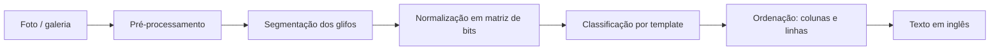

# Plano: leitor e tradutor do alfabeto Zu (Fez) em Kotlin

> Projeto de fã, sem vínculo com a Polytron. Não usamos sprites, logos nem assets do jogo:
> o ícone (chapéu fez) e a paleta são arte original inspirada no clima do jogo.

## 1. Objetivo

Um app Android simples:

1. **Tirar uma foto** (ou escolher da galeria) de um texto escrito no alfabeto Zu.
2. **Ler os glifos** da imagem e montar o texto (em inglês, porque o Zu é uma cifra de substituição do alfabeto latino).
3. ~~Traduzir o texto para português~~: fora do escopo por enquanto (fase opcional no fim). O app mostra o texto em inglês.

Nome sugerido: **Zu Reader**. Evitar "Fez" no nome publicado na Play Store para não esbarrar em marca registrada. O repositório pode continuar `fez-translate`.

## 2. O alfabeto Zu (validado na Fase 1)

| Ponto | O que sabemos | Como o app trata |
|---|---|---|
| Natureza | Cifra de substituição: cada glifo = uma letra latina | Tabela glifo → letra (`ZuAlphabet`) |
| Forma | Grade 5×5 de blocos | `BitMatrix` 5×5 |
| Quantidade | **24 glifos para 26 letras**: K/Q e U/V compartilham glifo | O modelo de inglês escolhe a letra pelo contexto (QUICK, OVER) |
| Estrutura | **6 formas, cada uma em 4 rotações** (ex.: A, G, M, S são a mesma forma girada) | Nunca girar glifo por glifo: a rotação muda a letra |
| Rotação da foto | Um texto girado também forma letras válidas | Testar as 4 orientações do texto inteiro e escolher a mais parecida com inglês |
| Direção | Colunas de cima para baixo, da direita para a esquerda | Padrão; opção horizontal |
| Números | Sistema separado (0–10, com variantes de 3–7). Também trocam de valor ao girar (1, 2, 3, 4 são o mesmo desenho) e ficam a 2 blocos de algumas letras | Por enquanto o app lê só a escrita. Depois: **modo separado** "ler números" (Fase 8), para não misturar letras e números na mesma leitura |

Fonte dos desenhos: [FEZ Pixel Font, de TakWolf](https://github.com/TakWolf/fez-pixel-font) (CC0). O alfabeto pertence à Polytron.

Referências: [StrategyWiki: Fez/Alphabet](https://StrategyWiki.org/wiki/Fez/Alphabet), [dCode: Fez alphabet](https://www.dcode.fr/fez-alphabet), [Zu Language typeface (itch.io)](https://themizarkshow.itch.io/zu-language).

## 3. Arquitetura

### Stack

| Camada | Escolha | Por quê |
|---|---|---|
| Linguagem | Kotlin 2.x | Pedido do projeto |
| UI | Jetpack Compose + Material 3 | Tema próprio com a paleta do design |
| Câmera | CameraX (`Preview`, `ImageCapture`, `ImageAnalysis`) | Preview e detecção ao vivo |
| Galeria | Photo Picker (`PickVisualMedia`) | Sem permissão de armazenamento |
| Visão | Kotlin puro (`core/vision`); OpenCV só se a Fase 3 pedir correção de perspectiva | Glifos são blocos: limiar, manchas e grade bastam. Testável na JVM e sem 30 MB de bibliotecas nativas |
| Classificação | Template matching (MVP) → TensorFlow Lite (Fase 6) | MVP sem treinar modelo |
| Tradução (opcional, depois) | ML Kit Translation (EN → PT, on-device) | Só se for retomada: gratuito e funciona offline após baixar o pacote |
| Persistência | Room (histórico) + DataStore (preferências) | |
| DI | Hilt | |
| Imagens | Coil | |
| Testes | JUnit 5, Turbine, Compose UI Test | |
| CI | GitHub Actions (build + testes + lint) | |

`minSdk 26`, `targetSdk` mais recente. Tudo roda no aparelho, sem servidor.

### Módulos

```
fez-translate/
├── app/                      # Activity, navegação, tema, DI
├── core/zu/                  # Kotlin puro: alfabeto, BitMatrix, decoder, ordenação
├── core/vision/              # Kotlin puro: limiar, manchas, caixas de glifo, grade 5×5
├── core/data/                # Room, DataStore, repositórios
├── feature/home/
├── feature/camera/
├── feature/result/           # resultado + correção de letra
└── feature/history/
```

`core/zu` é Kotlin/JVM puro: toda a lógica de reconhecimento testável sem emulador.

### Modelos principais (`core/zu`)

```kotlin
class BitMatrix                       // grade de blocos; rotate(), hammingDistance()
data class ZuGlyph(val letters: String, val pattern: BitMatrix)   // "KQ", "UV" ou uma letra
data class PlacedGlyph(val x: Float, val y: Float, val size: Float, val bits: BitMatrix)

class GlyphClassifier { fun classify(bits: BitMatrix): GlyphClassification }
object ZuLayout { fun order(...); fun compose(text, ...); fun rotate(glyphs, quarterTurns) }

class ZuReader { fun read(glyphs: List<PlacedGlyph>, rotation: Int? = null): ZuReading }
data class ZuReading(val text: String, val glyphs: List<GlyphReading>, val rotation: Int, ...)
data class GlyphReading(val source: PlacedGlyph, val letter: Char, val confidence: Float,
                        val alternatives: List<LetterScore>)
```

A Fase 2 só precisa transformar a foto em `List<PlacedGlyph>`; o resto já existe.

## 4. Pipeline de leitura



1. **Limiar**: escala de cinza (transparência vira branco) e limiar de Otsu. Testa texto escuro e texto claro e fica com o que encontra mais glifos confiáveis.
2. **Manchas**: componentes conectados (vizinhança de 8).
3. **Caixas de glifo**: a maioria dos glifos tem duas peças separadas por 1 bloco, o mesmo vão entre glifos, então não dá para juntar por distância. Mas todo glifo tem tinta em todas as linhas e colunas: a sombra das peças em cada eixo é contínua e do tamanho do glifo. Corta-se em faixas por um eixo e depois pelo outro (as duas ordens são testadas). Manchas grandes demais (molduras, cenário), sujeira e quadrados sólidos são descartados.
4. **Grade 5×5 de cada glifo**: cada célula vira bloco se mais da metade do seu miolo for tinta → `BitMatrix`. Células "meio a meio" indicam ruído e o glifo é descartado.

Antes do passo 2, a inclinação é medida (±12°) e a máscara é endireitada; a leitura endireitada só é usada se for melhor que a original. No passo 3, largura e altura do glifo são medidas separadamente (aceita imagem esticada) e glifos de tamanhos diferentes formam blocos separados, lidos com a mesma orientação.
5. **Classificação**: distância de Hamming contra os 24 modelos, sem girar o glifo. Confiança = folga para o segundo colocado × proximidade do modelo (exato = 1; 1 bloco errado sem empate = 0,8; empate = 0). Abaixo de 0,7 vira "letra com dúvida" (dourado na UI).
6. **Ordenação**: agrupar em colunas pelo centro X (tolerância de meio glifo); colunas da direita para a esquerda, glifos de cima para baixo. Fim de coluna e vãos maiores que 1,75 glifo viram espaço (suposição a validar com prints reais).
7. **Texto e orientação**: para cada uma das 4 orientações, Viterbi sobre pares de letras do inglês escolhe a sequência mais provável (resolve K/Q, U/V e blocos com ruído). Vence a orientação de maior pontuação; girar a foto tem um custo fixo, porque fotos costumam estar em pé e textos de até 3 letras são ambíguos.
8. **Tradução**: fora do escopo por enquanto.

Na câmera ao vivo, os passos 1 a 5 rodam no `ImageAnalysis` a cada ~300 ms em resolução reduzida, só para desenhar as caixas e o contador "7 glifos". A leitura completa roda na foto em resolução cheia.

## 5. Telas (ver `docs/design/mockup.html`)

1. **Início**: botão "Fotografar" (vermelho), "Escolher da galeria", lista de recentes.
2. **Câmera**: guia com cantos dourados, caixas turquesa nos glifos detectados, dourado nos duvidosos, contador de glifos, flash, galeria.
3. **Resultado**: foto com as caixas, texto lido em fonte pixel, faixa glifo → letra, ações Copiar / Compartilhar / Salvar.
4. **Corrigir letra** (bottom sheet): glifo ampliado, até 3 sugestões, teclado A–Z. A correção atualiza o texto na hora. Usar as correções para melhorar o reconhecimento fica para a Fase 6.
5. **Histórico** e **Configurações** (direção de leitura, tema claro/escuro).

### Identidade visual

| Token | Cor | Uso |
|---|---|---|
| Night | `#1E1B3A` | Fundo (céu noturno) |
| Surface | `#2A2650` | Cards, sheets |
| Fez Red | `#D7263D` | Ação principal |
| Fez Deep | `#A3172B` | Pressionado, sombra do botão |
| Cube Gold | `#F5B700` | Destaques, letra com dúvida, links |
| Scan Teal | `#4FC3C9` | Glifo detectado, sucesso |
| Paper | `#FFF6E5` | Texto principal |
| Muted | `#A9A3C9` | Texto secundário |

Fontes: **Silkscreen** (títulos e texto lido, pixel), **Figtree** (interface), **JetBrains Mono** (números/confiança), todas OFL, empacotadas em `res/font`.
Ícone: `docs/design/icon.svg` (chapéu fez 16×16), convertido em adaptive icon (foreground vetorial + fundo `#1E1B3A`).

## 6. Fases

| Fase | Entrega | Pronto quando |
|---|---|---|
| **0. Setup** ✅ | Projeto Gradle multi-módulo (version catalog), tema Compose com a paleta, ícone, CI no GitHub Actions. JDK 25 LTS, Gradle 9.8.2, Kotlin 2.4.21, AGP 9.5.1 | `./gradlew build` verde no CI; app abre a tela inicial |
| **1. Alfabeto + decoder** ✅ | `core/zu`: 24 glifos, classificador por distância, ordenação de colunas, modelo de pares de letras do inglês, escolha da orientação | Testes: frases sintéticas lidas certas em pé e giradas (≥ 4 letras); 99,8% de acerto por caractere com 1 bloco errado em cada glifo |
| **2. Visão em imagem estática** 🟡 | `core/vision` (Kotlin puro); galeria → tela de resultado com caixas, texto e letra a letra | Imagens sintéticas: 100% com borrão, ruído, JPEG, escala, baixo contraste, sujeira, cenário e foto girada. **Falta**: ≥ 95% em 30 prints reais do jogo |
| **2.5. Glifos distorcidos e de tamanhos variados** ✅ | Largura e altura do glifo medidas separadamente; grupos por tamanho (ex.: título e corpo, separados por quebra de linha); inclinação corrigida pela projeção mais "pontuda" (±12°), usada só quando melhora a leitura; filtro de nitidez e tamanho mínimo (2 px por bloco) contra ruído | Testes sintéticos: 100% com esticamento vertical e horizontal de 0,5× a 3×, inclinação de ±3° a ±10°, título grande + texto pequeno (também com a foto girada) e combinação inclinada + esticada + JPEG. Leitura de 1680×1309 px em ~200 ms na JVM |
| **3. Câmera** 🟡 | CameraX (preview, análise e captura em 4:3); permissão com explicação e atalho para as configurações; visor ao vivo com caixas, contador e texto lido a cada 300 ms (quadros de 640 px, só o plano Y); flash; captura girada e reduzida fora da thread principal; tela de recorte com 4 cantos arrastáveis (sugestão automática em volta do texto) e correção de perspectiva por homografia | Testes sintéticos: foto de lado em trapézio não é lida sem recorte e é lida 100% depois (também com cantos marcados com erro de alguns pixels); conversão de quadros e mapeamento das caixas testados. **Falta**: ≥ 85% em 30 fotos reais de monitor/TV e teste em aparelho |
| **4. Correção e histórico** ✅ | Toque numa letra da faixa abre o painel de correção (glifo ampliado, sugestões, teclado A–Z); letras corrigidas ficam em turquesa e deixam de ser dúvida. Salvar guarda imagem (JPEG) e leitura completa (Room 2.8.5 + formato `ReadingCodec`); correções numa leitura salva são gravadas na hora. Recentes na tela inicial, tela de histórico, apagar com confirmação | Testes: troca de letra mantendo espaços e quebras de linha; gravação e leitura da leitura completa (ida e volta, inclusive com letra corrigida, inclinação e dois blocos). Banco verificado em compilação pelo Room. **Falta**: testar o fluxo num aparelho |
| **5. Polimento** ✅ | Tema claro completo (e câmera sempre escura); configurações com direção de leitura, tema e "Sobre" com créditos e licenças (DataStore 1.3.0); contraste revisado (texto ≥ 4,5:1, bordas de controles ≥ 3:1 nos dois temas); alvos de toque ≥ 48 dp (teclado de correção com 6 teclas por linha, faixa de letras, botões da câmera); títulos de seção anunciados como títulos; texto lido ao vivo anunciado pelo leitor de tela; rótulos que encolhem com fonte grande; release com R8 (APK de 2,5 MB) e assinatura opcional por secrets; CI publica APK e AAB; ícone 512 px para a loja | Build de release verificado (sem assinatura e com chave de teste). Capturas em tema claro, configurações e fonte 150%. **Falta**: rodar o TalkBack num aparelho |
| **6a. Aprender com as correções** ✅ | Ao corrigir uma letra, o desenho do glifo (na orientação de leitura) vira um exemplo do usuário (Room, até 300, migração automática 1→2). O classificador compara com o alfabeto e com os exemplos; um exemplo só vence se estiver mais perto (empate = alfabeto) e, se for idêntico, vale contra o contexto do inglês. Vale para galeria, câmera e visor ao vivo. Botão "Esquecer correções" nas configurações | Testes: um "E" deformado que o alfabeto lê como outra letra passa a ser lido certo no texto inteiro depois de um exemplo, também com a foto girada; empate continua com o alfabeto; exemplos da mesma letra não tiram confiança |
| **6b. Modelo treinado (opcional)** | Modelo TFLite treinado com dados sintéticos + exemplos do usuário; leitura totalmente ao vivo | Acurácia em fotos ≥ 95%; só se a leitura por distância não bastar com fotos reais |
| **7. Tradução (opcional)** | ML Kit Translation EN → PT no aparelho, mostrando inglês e português | Só se o projeto decidir retomar a tradução |
| **8. Números (depois)** | Modo separado na tela inicial e na câmera: **Ler escrita** (atual) ou **Ler números**. O modo números usa só os glifos 0–10 (e variantes), sem o modelo de inglês; a orientação vem da foto ou de outros glifos lidos. Antes, entender com prints reais como os números aparecem no jogo (quantidades ou códigos de comandos) | Testes sintéticos com sequências de números em pé e giradas; validação com prints reais |

### Dados de teste

- **Prints**: capturas do próprio jogo (de quem tem o jogo), guardadas fora do repositório público se houver dúvida de direitos.
- **Sintéticos**: script que renderiza os templates com ruído, desfoque, perspectiva, moiré e variação de cor. Serve para os testes da Fase 2 e para treinar o modelo da Fase 6.
- Métrica: taxa de acerto por letra e por frase, registrada a cada PR no CI.

## 7. Riscos

| Risco | Mitigação |
|---|---|
| Moiré e reflexo em foto de tela | Desfoque antes do limiar, dica na câmera ("afaste um pouco"), importar print pela galeria |
| K/Q e U/V com o mesmo glifo; B/H/N/T e F/L/R/Y a 2 blocos de distância | Contexto do inglês escolhe; empates marcados como dúvida com alternativas |
| Texto girado | As 4 orientações são testadas; textos de até 3 letras ficam na orientação da foto |
| Foto muito de lado (texto em trapézio) | Recorte por 4 cantos com correção de perspectiva (Fase 3) |
| Glifos colados ou muito pequenos | Exigir tamanho mínimo; recorte manual; zoom na câmera |
| Foto de lado ou imagem esticada deixa o glifo retangular | Resolvido na Fase 2.5 (esticamento até 3×, inclinação até ±10°). Perspectiva forte (trapézio) fica para a Fase 3 |
| Marca "Fez" | Nome do app sem "Fez"; aviso de projeto de fã; nenhum asset do jogo |

## 8. Próximos passos

1. Aprovar este plano e o design (`docs/design/mockup.png`).
2. Fase 0: criar o projeto Android no repositório.
3. Fechar a Fase 2 com prints reais do jogo: medir o acerto e validar a direção de leitura, como as palavras são separadas e a orientação dos glifos.
4. Testar num aparelho real: câmera, histórico e TalkBack; medir o acerto com prints e fotos de monitor/TV.
5. Depois: Fase 6 (melhorar o reconhecimento), Fase 8 (números) e Fase 7 (tradução), quando decidido.
